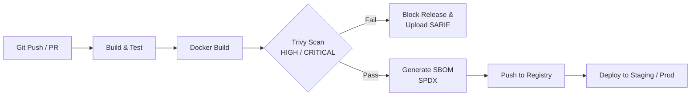

# DevSecOps Pipeline Templates

[](https://github.com/papilias/devsecops-pipeline-templates/actions/workflows/lint.yml)

Production-ready, reusable CI/CD templates for **Azure DevOps** and **GitHub Actions** designed to standardize container builds, enforce automated security gates, and generate SBOMs across multiple engineering teams.

## Pipeline Flow



## Repository Structure

```text
.
├── azure-devops/
│   └── templates/
│       └── docker-trivy-scan.yml      # Reusable Azure DevOps job template (Build + Trivy + SBOM)
├── github-actions/
│   └── reusable-devsecops.yml         # Reusable GitHub Actions workflow (Build + Trivy + SARIF)
└── .github/
    └── workflows/
        └── lint.yml                   # Automated YAML linting on every push/PR
```

## Design Decisions
- **Fail-Fast Security Gates:** Builds fail automatically on `CRITICAL` vulnerabilities with available fixes (`--ignore-unfixed`), preventing known exploitable CVEs from reaching production while avoiding alert fatigue from unpatchable upstream issues.
- **Template Centralization:** Centralizing pipeline logic in reusable templates prevents copy-paste drift across microservices and allows rolling out compliance updates (e.g., new Trivy rules or SBOM formats) from a single repository.
- **Registry-Agnostic:** Templates accept registry credentials and image tags as parameters, supporting ACR, ECR, and GHCR without modifying core steps.
